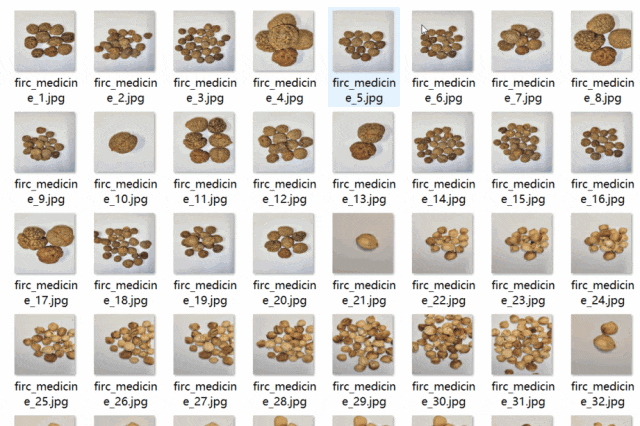
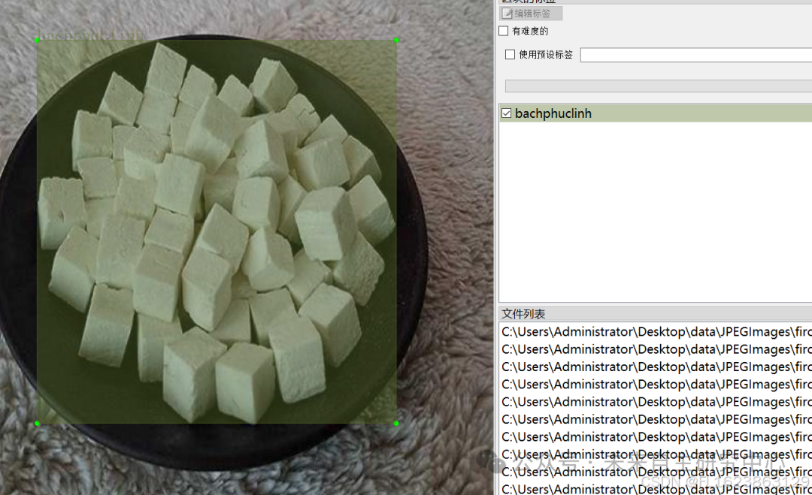

# [Dataset] Object Detection - Herbal Medicine Type Identification Detection Dataset VOC+YOLO format with 7976 images and 45 categories

Dataset format: Pascal VOC format + YOLO format (txt file without split path, only containing jpg images and corresponding VOC format xml files and yolo format txt files)
Number of images (number of jpg files): 7976
Number of annotations (number of xml files): 7976
Number of annotations (number of txt files): 7976
Labeling category count: 45
Product Technical Requirements:
Number of boxes labeled in each category:

| Serial Number || Category Name || Box Count |

| 1 || bachphuclinh || 154 |
| 2 || bachthuoc || 125 |
| 3 || bachtruat || 153 |
| 4 || bocotchi || 197 |
| 5 || camthao || 126 |
| 6 || chitu || 210 |
| 7 || dangsam || 119 |
| 8 || daonhan || 177 |
| 9 || daonhan_tachvo || 184 |
| 10 || diaphutu || 300 |
| 11 || donbi || 82 |
| 12 || dongtrung || 273 |
| 13 || dotrong || 113 |
| 14 || duongquy || 208 |
| 15 || hanhnhan || 201 |
| 16 || hoaison || 139 |
| 17 || hoangky || 198 |
| 18 || kimanhtu || 166 |
| 19 || kytu || 510 |
| 20 || lienkieu || 366 |
| 21 || liennhuc || 443 |
| 22 || machmon || 186 |
| 23 || mocqua || 221 |
| 24 || ngoctruc || 107 |
| 25 || nguvitu || 311 |
| 26 || nhannhuc || 297 |
| 27 || nhansam || 110 |
| 28 || omai || 211 |
| 29 || phucbontu || 189 |
| 30 || qualaubi || 183 |
| 31 || que || 241 |
| 32 || sanhanthuong || 233 |
| 33 || sanhantron || 106 |
| 34 || sonthudu || 318 |
| 35 || sontra || 142 |
| 36 || taodo || 523 |
| 37 || thaodaukhau || 117 |
| 38 || thucdia || 376 |
| 39 || tieuhoi || 185 |
| 40 || trachta || 193 |
| 41 || tranbi || 131 |
| 42 || xuyenboimau || 246 |
| 43 || xuyenkhung || 217 |
| 44 || xuyenluyentu || 169 |
| 45 || ydi || 190 |
Total || 45 || 9646

Using labelImg:

Annotation rules: Rectangular boxes are drawn around categories.
Important note: No specifics available.
Special statement: This dataset does not guarantee the accuracy or precision of models trained on it, nor does it provide accurate and reasonable annotations.
Image preview:

Annotation example:

## Payment

Here is a pay link on Stripe ( https://buy.stripe.com/3cs8yP7sY87d0vu9AB ). Please contact me lonlonago@foxmail.com after funding $89, and I will send you a complete data files , thank you!

